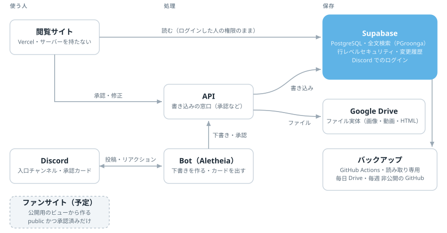

# aletheia

アイドルの活動を客観的事実として蓄積・検索するアーカイブシステム。

本人の発言・メンバーからの言及・仕事の記録を、出典つきの事実としてデータベースに蓄積し、検索できるようにする。設計は特定のメンバーに依存せず、人物・情報源・語彙はすべてデータとして持つ。

## 設計の要点

- **取り込みは承認制**: 機械は下書き（`intake_items`）を作り、人が承認したものだけが事実の層に入る
- **事実は 3 つの層**: 素材（`assets`）、日付を持つ活動（`events`）、人物についての言明（`statements`）。いずれも出典に紐付ける
- **すべての紐付けに出どころ**: 人・ルールのどれが付けたか、確信度、根拠を 1 件ごとに記録する
- **AI は基本的に使わない**: 振り分けと提案は規則で、規則で決められないものは人が行う（設計書 決定記録 0011）
- **公開区分は仕組みで守る**: すべての行が `public`（公開）か `private`（非公開）を持つ。設定し忘れた行は `private` になり、登録のない利用者には何も見えない
- **有料の情報源は、原文を再現させない**: 有料の素材そのものは公開しない。読み取った事実は公開してよいが、原文と連続 20 文字以上一致する値は出さない
- **変更履歴**: 更新・削除の前の行を自動で保存する。履歴は追記のみ
- **運用の仕組みもデータベースに**: 収集カバレッジ（観点 × 情報源、アイテム単位の確認）、記録漏れの候補、重複の疑い、定期処理の実行記録、データ品質の検査（`app.run_quality_checks()`）
- **日本語の全文検索**: PGroonga。検索の処理は 1 か所（`search_texts`）に閉じ込める
- **日付は JST**: 日付のみは `date` + 精度（`date_precision`）、時刻つきは `timestamptz`

## 仕組み

<picture>
  <source media="(prefers-color-scheme: dark)" srcset="docs/images/architecture-dark.svg">
  
</picture>

- **書き込みの窓口は API の 1 か所**: 閲覧サイトも Bot も、承認などの書き込みは API を通す
- **読み取りはデータベースが守る**: 閲覧サイトはログインした人の権限のまま読み、見える範囲は行レベルセキュリティが決める
- **費用は無料の範囲**: Supabase・Vercel・Google Drive・GitHub Actions の無料枠で動く。API は当面、運営者の PC で動かす

1 つの素材（アセット）が持つ情報の一覧は [docs/data.md](docs/data.md)。

## 構成

| 場所                   | 内容                                                                                                           |
| ---------------------- | -------------------------------------------------------------------------------------------------------------- |
| `supabase/migrations/` | データベースの構造（正）。Supabase CLI で適用する                                                              |
| `packages/db/`         | データベースへの接続、型の定義、データベースのテスト（公開区分・公開用の書き出し・変更履歴・検索・整合・運用） |
| `packages/intake/`     | 取り込みの下書きの形と、承認・却下・保留の処理                                                                 |
| `packages/storage/`    | ファイル実体の保存先（Google Drive・手元のフォルダ）と、置き場所・ファイル名の規則                             |
| `packages/backup/`     | データベースのバックアップ（表ごとの JSON Lines・SQL のダンプ・件数の照合・SHA-256 の一覧と、Drive への配置）  |
| `apps/api/`            | 承認・取り込みの API（Bot・閲覧サイトから呼ぶ）                                                                |
| `apps/bot/`            | Discord Bot（入口チャンネルから下書きを作り、承認カードを出す）                                                |
| `apps/viewer/`         | 閲覧サイト（見る・探す・下書きの確認と承認）。Discord でログインする                                           |

## データベースのロール

| 使う側                   | ロール                   | 見える範囲                           |
| ------------------------ | ------------------------ | ------------------------------------ |
| 閲覧サイト（未ログイン） | `anon`                   | なし                                 |
| 閲覧サイト（ログイン）   | `authenticated`          | 招待した利用者はすべて。読み取りのみ |
| API（承認・取り込み）    | `postgres`               | すべて（直接接続）                   |
| 公開サイト用の書き出し   | `aletheia_public_export` | `public_export` スキーマのビューのみ |
| バックアップ             | `aletheia_backup`        | すべての行（読み取りのみ）           |

ロールのログインとパスワードはマイグレーションに書かず、本番の設定時に運営者が行う。

閲覧サイトには Discord のアカウントでログインする（Supabase Auth の Discord 連携）。利用者は Discord のユーザー ID で `app.user_profiles` に登録し、ログインした人の照合は認証の記録（`auth.identities`）で行う。登録の無い人はログインできても何も見えない。利用者の登録は、管理者が閲覧サイトで作る招待リンク（1 回限り・7 日・閲覧者だけ）で行う（設計書 決定記録 0019）。

公開サイト用のビューは「公開区分が `public` かつ 承認済み」の行だけを出す。有料の素材そのもの（投稿・本文・画像・動画）は出さず、有料の素材から読み取った言明は、根拠の素材を指さずに情報源と日付だけを示す。

## 開発の準備

必要なもの: Node.js 22 以上、pnpm、Docker、[Supabase CLI](https://supabase.com/docs/guides/local-development/cli/getting-started)、[gitleaks](https://github.com/gitleaks/gitleaks)

```sh
pnpm install          # コミット前のチェック（lefthook）も有効になる
cp .env.example .env
supabase start        # 手元にデータベースを立ち上げ、マイグレーションを適用する
pnpm test             # データベース・承認の処理・API・Bot・閲覧サイトのテスト
pnpm check            # lint・format・typecheck
```

マイグレーションを変えたら `supabase db reset` で作り直し、`pnpm --filter @aletheia/db gen:types` で型の定義（`packages/db/src/database.ts`）を作り直してからテストする。

## 品質チェック

人の手間を増やさずに、規約の守り忘れを機械が止める。すべて無料の道具で動く。

| いつ                             | 何を                                                                                                                                                                          |
| -------------------------------- | ----------------------------------------------------------------------------------------------------------------------------------------------------------------------------- |
| コミット前（lefthook）           | 鍵の混入（gitleaks）、マイグレーションの規約、lint、format、typecheck                                                                                                         |
| プルリクエスト（GitHub Actions） | 上記に加えて、ワークフローの検査（actionlint）、リンク切れ（lychee）、データベースを立ち上げてマイグレーションの適用・関数の静的検査（plpgsql_check）・型の定義の鮮度・テスト |

データベースのテストが確かめること:

| 分類             | 内容                                                                                                                                             |
| ---------------- | ------------------------------------------------------------------------------------------------------------------------------------------------ |
| 見える範囲       | 招待した利用者にはすべて見えること、登録のない人・未ログイン・Discord 以外でログインした人には何も見えないこと、閲覧サイトから書き込めないこと   |
| 招待リンク       | 管理者だけが作れること、1 回限り・期限・取り消しが効くこと、付く役割が閲覧者だけであること、リンクの値をデータベースに残さないこと               |
| 公開用の書き出し | `public` かつ 承認済みの行だけが出ること、有料の素材そのものと有料の原文を再現する値が出ないこと、非公開の参照先を伏せること、内部の列が無いこと |
| 変更履歴         | 更新・削除の前の行と変更者が残ること、履歴を書き換えられないこと                                                                                 |
| 整合             | 同じ投稿・同じファイル・表記揺れの人物が重複しないこと、紐付けの両端が実在すること、日付の精度                                                   |
| 構造             | 後から追加した表にも公開区分・行レベルセキュリティ・履歴・索引・説明がそろっていること、関数の権限と search_path                                 |
| 検索             | 日本語の部分一致、全角・半角、登録のない人には出ないこと                                                                                         |
| バックアップ     | バックアップ用のロールですべての表のすべての行を書き出せること、読めない表があれば失敗すること、記録にデータの中身と接続先を出さないこと         |
| 運用             | メモ・記事の参照先の実在、収集カバレッジの重複防止、止まっている定期処理の検知、データ品質の検査（発見・解消・対象外）                           |

CI が失敗しているプルリクエストは取り込まない。

## 参加する

開発への参加の手順は [参加ガイド](CONTRIBUTING.md) にある。
